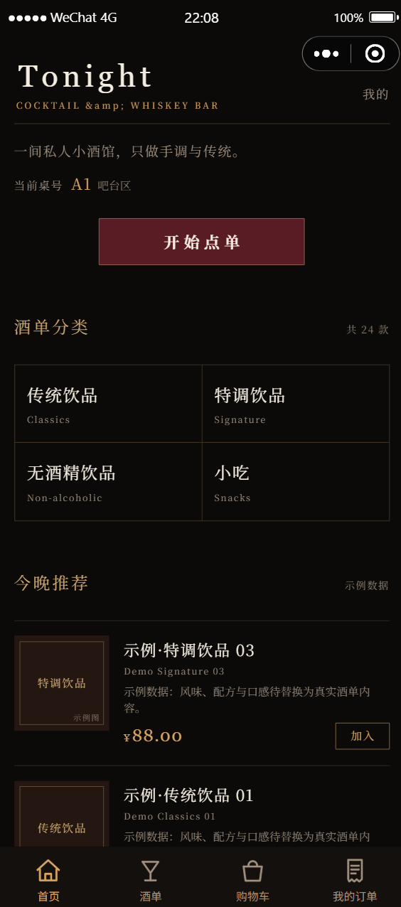
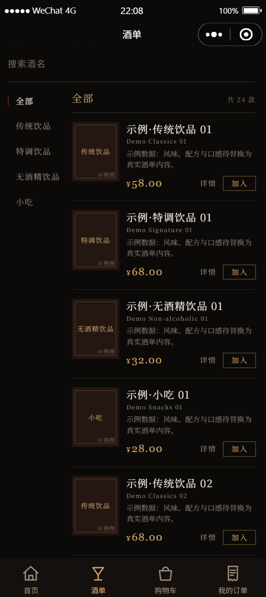
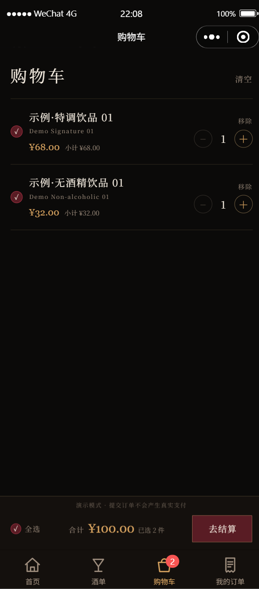
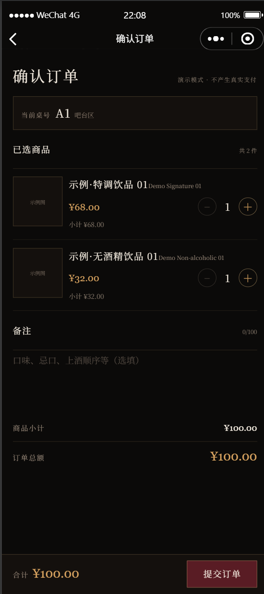
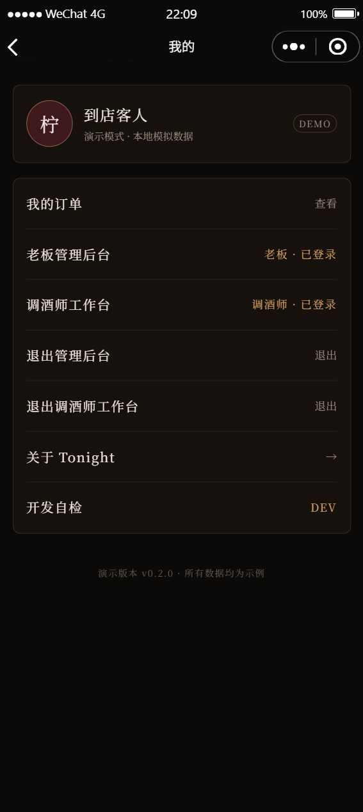
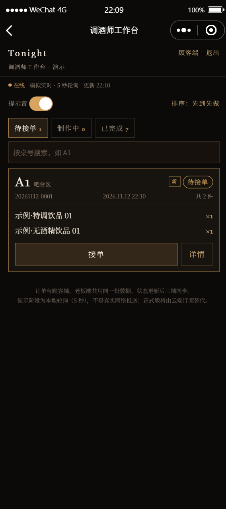
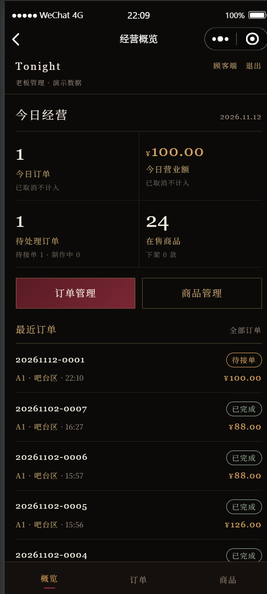

# Tonight · COCKTAIL & WHISKEY BAR

**预览版 Demo**：一家私人小酒馆的微信小程序原型，顾客扫桌号二维码点单，订单在老板管理端与调酒师工作台之间流转。
纯微信原生（JavaScript / WXML / WXSS），零 npm 依赖、零网络请求、断网可跑，全部数据走本地 Mock。


> ⚠️ **这是预览版**：仓库是一份完整的、可运行的交互与代码结构示例，用来展示点单流程与多角色界面。
> 它**不接后端、不接支付**，也没有生产环境的服务端校验与实时推送；代码仅供参考，请勿直接用于线上经营。

> **English** — A preview demo of a WeChat Mini Program for a single-location cocktail bar: QR-code table ordering, order lifecycle, an owner admin console and a bartender board. Runs entirely on local mock data (no backend, no network). For demonstration only; licensed under Apache-2.0.

---

## 目录

- [界面预览](#界面预览)
- [功能](#功能)
- [技术栈与设计取舍](#技术栈与设计取舍)
- [快速开始](#快速开始)
- [演示账号](#演示账号)
- [自动检查](#自动检查)
- [目录结构](#目录结构)
- [文档](#文档)
- [已知限制](#已知限制)
- [授权](#授权)
- [免责声明](#免责声明)

## 界面预览

<p align="center">
  
  
  
  
</p>
<p align="center">
  
  
  
  
</p>

> 截图取自开发者工具模拟器，内容为本地演示数据。

## 功能

### 顾客端（Tab：首页 / 酒单 / 购物车 / 我的订单）

| 页面 | 能力 |
| --- | --- |
| 欢迎页 | 纯文字排版：`#100D0E` 底 + 八公明朝子集 + 0.10–1.10s 淡入时序，可跳过 |
| 首页 | 品牌区、扫码桌号、四分类入口、今晚推荐（可直接加购）、当季推荐 |
| 酒单 | 竖排分类栏（全部 + 4 类）、名称搜索、编辑式列表、条目内加购 |
| 商品详情 | 图片 / CSS 酒标占位块、介绍、数量步进、加入购物车、下架态 |
| 购物车 | 勾选 / 全选、改数量、移除、清空、已选合计、去结算 |
| 订单确认 | 桌号校验（缺失即拦截）、清单、备注（≤100 字）、总额、提交 |
| 我的订单 | 四状态筛选（默认待接单）、下拉刷新、空态 |
| 订单详情 | 编号 / 时间 / 桌号 / 清单 / 金额 / 备注 / 状态时间线、待接单可取消 |
| 我的 | 订单入口、老板后台入口、调酒师工作台入口、开发自检（仅开发版） |

### 老板端（独立口令，不进顾客 Tab）

- **经营概览**：今日订单数、营业额、待处理数、在售商品数、异常提示、最近 5 单
- **订单管理**：全部 + 四状态筛选（带计数）、订单详情
- **订单处理**：确认接单、完成制作、取消（必须填原因）、标记 / 处理异常
- **商品管理**：分类筛选、搜索、上下架开关、新增 / 编辑（价格按「元」输入，存储按「分」）

### 调酒师端（独立口令）

- **工作台**：待接单 / 制作中 / 已完成三栏、桌号搜索、先到先做 / 最新在前
- **新单提醒**：5 秒轮询 + 顶部提示条 + 「新」角标 + 可开关提示音
- **订单详情**：接单、制作完成、提交异常（缺货等）给老板；调酒师**不能取消订单、看不到金额**

### 订单状态机

```text
待接单 pending ──接单──▶ 制作中 making ──完成──▶ 已完成 completed
      └────────── 取消（顾客待接单时 / 老板填原因）──────────▶ 已取消 cancelled
```

## 技术栈与设计取舍

| 项目 | 选择 | 原因 |
| --- | --- | --- |
| 框架 | 微信原生（JS / WXML / WXSS） | 无构建步骤、无第三方 UI 库，页面代码可读性优先 |
| 数据层 | `services/*` + `wx.storage` | 先 Mock 后接 CloudBase；换后端只改 services，不动页面 |
| 数据版本 | `config/index.js` 的 `seedVersion` | 改种子数据后递增，客户端下次启动自动重建缓存 |
| 金额 | 以「分」存储与计算，展示转元 | 避免浮点误差；`utils/format.yuanToFen()` 走字符串解析 |
| 鉴权 | 本地口令 + 页面守卫（`admin-guard` / `bartender-guard`） | **仅演示**；生产环境必须由服务端校验角色 |
| 字体 | 八公明朝 43 字子集 base64 内嵌 | 断网可用、不依赖网络字体；OFL 1.1 允许嵌入 |
| 动效 | 全站仅欢迎页有纯 opacity 淡入 | 刻意克制，避免「模板感」 |

主包约 225 KB，其中 `styles/font-hakkou.wxss` 67.8 KB（内嵌字体）与 `assets/sounds/order-alert.wav` 20.7 KB（提示音）占比最大。

## 快速开始

1. 安装[微信开发者工具](https://developers.weixin.qq.com/miniprogram/dev/devtools/download.html)（稳定版）。
2. 克隆仓库并用开发者工具「导入项目」选择仓库根目录：

   ```bash
   git clone https://github.com/<your-name>/tonight-miniprogram.git
   ```

3. **AppID**：仓库里 `project.config.json` 填的是演示用 AppID。Fork 后请改成你自己的 AppID，或导入时选择「测试号」，否则无法预览与上传。
4. 点击「编译」。无需 `npm install`，也无需配置云开发环境。

> 书签式细节：`project.private.config.json` 是本机私有配置，已在 `.gitignore` 中排除，不会入库。

**模拟扫码进店**：开发者工具「编译模式」已预置 `pages/welcome/welcome?table=t_a1`（桌号 A1）与 `?table=t_b2`（桌号 B2）；也可在「我的 → 开发自检 → 当前桌号（调试）」里选桌，等价于扫码。

## 演示账号

| 角色 | 入口 | 口令 | 说明 |
| --- | --- | --- | --- |
| 顾客 | 欢迎页 → 首页 | — | 桌号只能由扫码参数 / 调试入口带入，不支持手动选桌 |
| 老板 | 我的 → 老板管理后台 | `8888` | 经营概览、订单处理、商品管理 |
| 调酒师 | 我的 → 调酒师工作台 | `1234` | 只处理订单流转，不能取消、看不到金额 |

> 口令写在 `config/index.js`，仅用于演示角色隔离。两个会话互相独立：`8888` 进不了调酒师端，`1234` 进不了老板后台。

## 自动检查

仓库自带 4 个纯 Node 脚本（无需安装依赖），对 services 层、页面守卫与关键交互做离线断言：

| 脚本 | 覆盖范围 | 断言数 |
| --- | --- | --- |
| `node scripts/verify_stage3.js` | 酒单、搜索、详情、加购、下架 | 41 |
| `node scripts/verify_stage5.js` | 购物车勾选、下单、金额快照、状态机 | 53 |
| `node scripts/verify_stage6.js` | 老板端权限、商品增改、统计口径 | 46 |
| `node scripts/verify_stage7.js` | 调酒师端权限、轮询提醒、异常流转 | 56 |

```bash
node scripts/verify_stage3.js && node scripts/verify_stage5.js \
  && node scripts/verify_stage6.js && node scripts/verify_stage7.js
# 合计 196 项断言，全部通过即退出码 0
```

[`.github/workflows/verify.yml`](.github/workflows/verify.yml) 会在每次 push / PR 时自动跑这 4 个脚本。

<!-- CI 徽章：把 OWNER/REPO 换成你的仓库后取消注释，放在文首徽章区

-->

## 目录结构

```text
├─ app.js / app.json / app.wxss / sitemap.json
├─ project.config.json          # 开发者工具项目配置（含演示 AppID）
├─ config/                      # useMock、演示口令、seedVersion、品牌文案
├─ pages/                       # 19 个页面，见下表
├─ components/                  # 通用组件（卡片、步进器、空态、状态标签、管理端导航）
├─ services/                    # 数据访问层：products / cart / orders / auth / stats / order-feed ...
├─ utils/                       # storage / format / 常量与状态机 / 守卫 / mock-data 种子
├─ styles/                      # theme.wxss + admin.wxss + bartender.wxss + 内嵌字体
├─ assets/                      # tabBar 图标、提示音、素材源文件（_src）
├─ docs/                        # 需求、设计、阶段交付说明、测试指引
├─ scripts/                     # 自检脚本与素材生成脚本（不进小程序包）
├─ screenshots/                 # README 截图
├─ .github/                     # Issue / PR 模板与 CI
├─ LICENSE / NOTICE / THIRD-PARTY-NOTICES.md
└─ README.md
```

| 目录 | 页面 |
| --- | --- |
| 顾客端 | `welcome` `home` `menu` `product` `cart` `order-confirm` `orders` `order-detail` `my` |
| 老板端 | `admin-login` `admin-overview` `admin-orders` `admin-order-detail` `admin-products` `admin-product-edit` |
| 调酒师端 | `bartender-login` `bartender-board` `bartender-order` |
| 开发辅助 | `dev-check`（连通性自检、重置演示数据、调试桌号，仅开发版入口） |

## 文档

完整文档索引见 **[docs/README.md](docs/README.md)**，常用入口：

| 文档 | 内容 |
| --- | --- |
| [测试指引](docs/13-测试指引.md) | 从冒烟到调酒师端的逐页手工测试步骤 |
| [需求文档](docs/01-需求文档.md) | 范围、功能、数据模型、页面要求、验收标准 |
| [视觉设计准则](docs/04-视觉设计准则.md) | 色板、字体、结构与动效、文案与评审清单 |
| [AI 交接说明](docs/06-AI交接说明.md) | 项目现状、16 条易踩坑、实现约束 |

## 已知限制

以下是预览版**有意保留的边界**，不是尚待完成的任务；本仓库只作为演示留存，不承诺迭代。

1. **没有后端**：所有数据在 `wx.storage`，清缓存 / 卸载即丢失；换设备不同步。
2. **没有支付**：`payStatus` 恒为 `unpaid`，界面上不存在支付入口。
3. **鉴权是模拟的**：口令写在客户端，只能演示角色隔离；生产环境必须由服务端校验，这不在本 Demo 范围内。
4. **不是实时推送**：调酒师端是 5 秒本地轮询，页面已常驻「模拟实时」标注。
5. **单品备注未做**：特殊制作要求只能写整单备注。
6. **图片只读**：老板端不提供上传；`services/media.js` 只是预留契约。
7. **仅在开发者工具模拟器中验证**：iOS / Android 真机适配与欢迎页字体混排未做真机确认。

## 授权

- 源代码与文档：[Apache License 2.0](LICENSE)，版权声明见 [NOTICE](NOTICE)。
- 内嵌字体（八公明朝 / 思源宋体子集）：[SIL Open Font License 1.1](THIRD-PARTY-NOTICES.md)，其授权**优先于** Apache-2.0。
- 其他素材来源见 [THIRD-PARTY-NOTICES.md](THIRD-PARTY-NOTICES.md)。

## 免责声明

本项目是**技术演示**，与任何真实门店、品牌、商标无关：

- 「Tonight」「COCKTAIL & WHISKEY BAR」及全部商品名称、价格、门店信息均为**虚构示例**，商品名统一带「示例·」前缀。
- 展示口令、Mock 鉴权、模拟推进等功能**仅用于演示**，不得直接用于生产环境。
- 未接入微信支付，不代表具备任何支付或经营资质。

欢迎提 Issue 交流实现思路；若要用于自己的项目，请先阅读 [CONTRIBUTING.md](CONTRIBUTING.md)。
